# Lublin Open Map

**An open 3D map of central Lublin, Poland, for games and engines.** About 5 × 3.5 km of the city:
photogrammetry of the Old Town and city centre, 3D buildings, streets with their real surfaces,
viaducts with piers, landmarks, breakable trees and signs, collision meshes, four race courses and
a traffic-lane network. Everything in open formats (glTF 2.0, GeoJSON, PNG), with guides for
open-source engines, simulators and classic games.

[Polski](README.md) · [Data format](docs/format.md) · [Integrations](docs/integration/README.md) ·
[Licences](LICENSES.en.md) · [For AI agents](AGENTS.md)

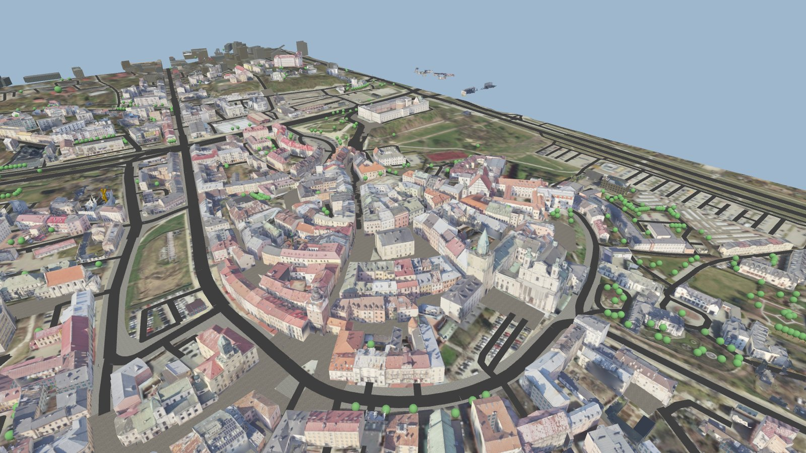

## Gallery

| | |
|---|---|
| 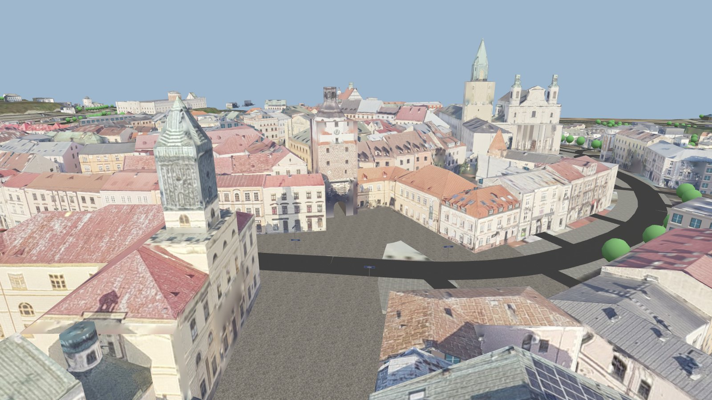 **Kraków Gate** from Łokietka Square | 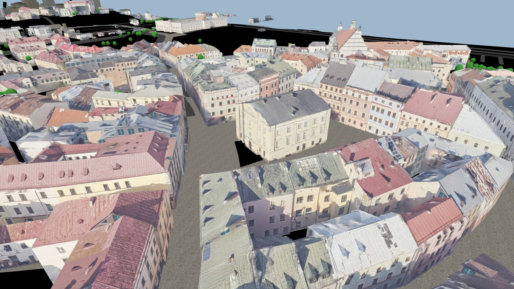 **Market Square and the Crown Tribunal** |
| 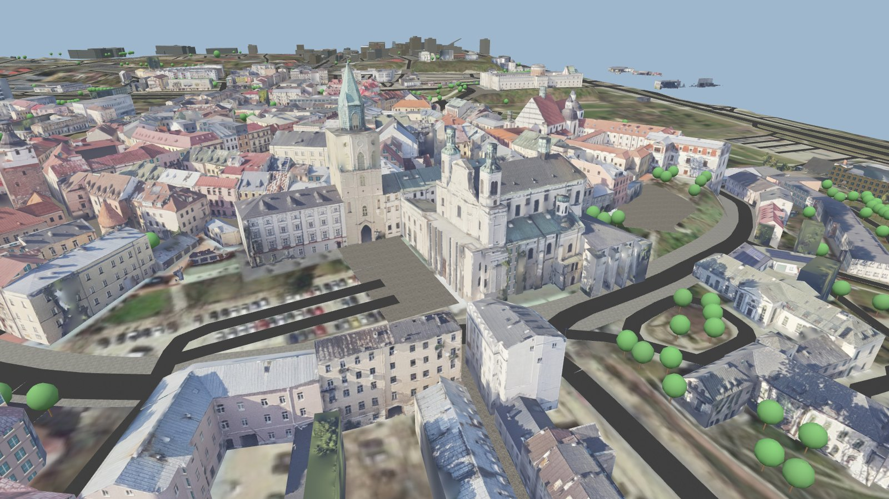 **Cathedral and Trinitarian Tower** | 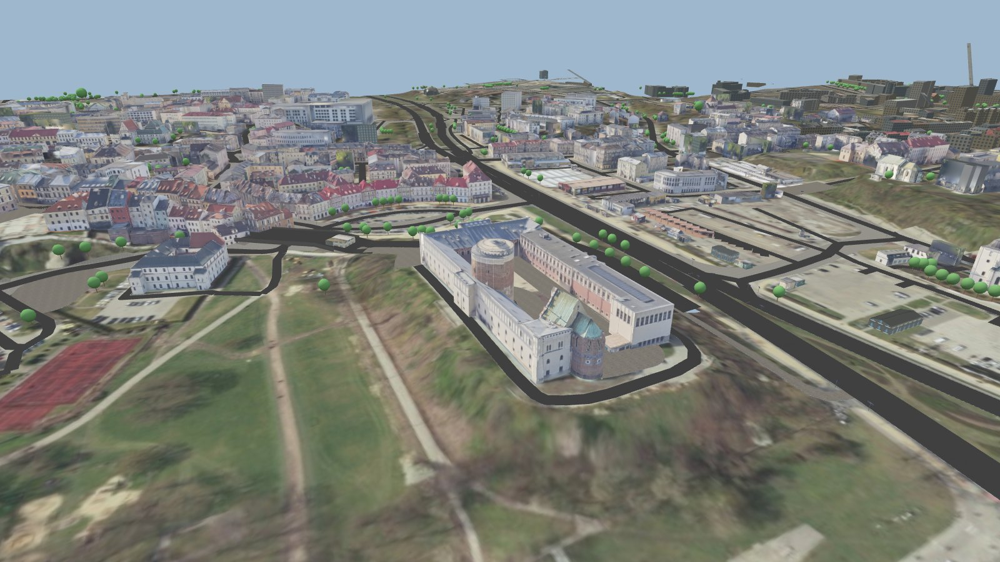 **Lublin Castle** |
| 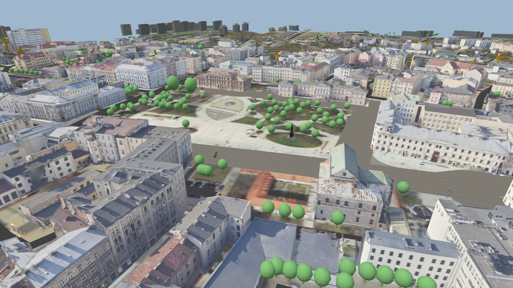 **Lithuanian Square** with the Union of Lublin monument and the Vilnius–Lublin Portal | 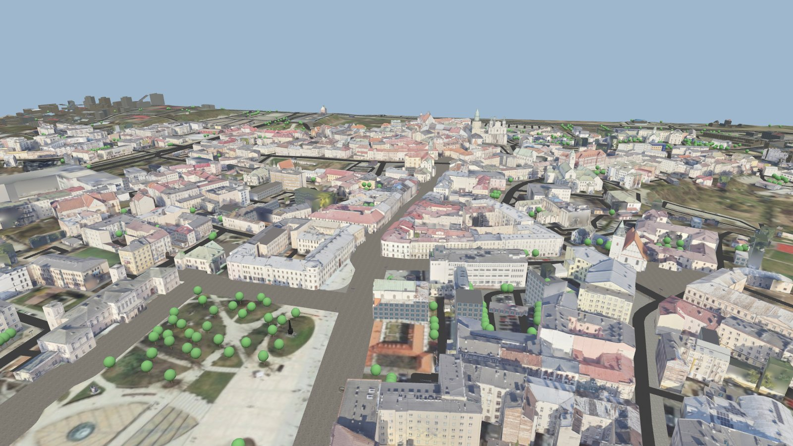 **Krakowskie Przedmieście** |
| 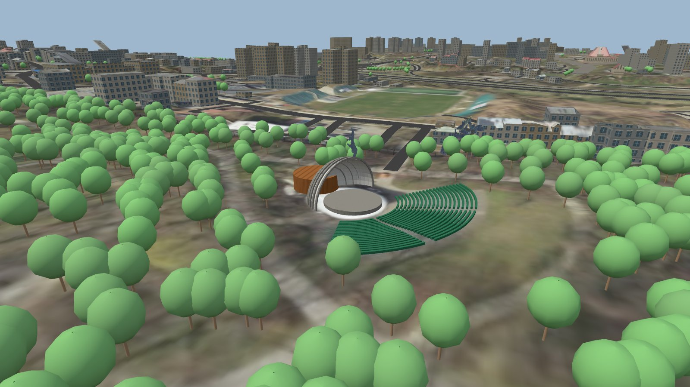 **Concert Shell, Saxon Garden** | 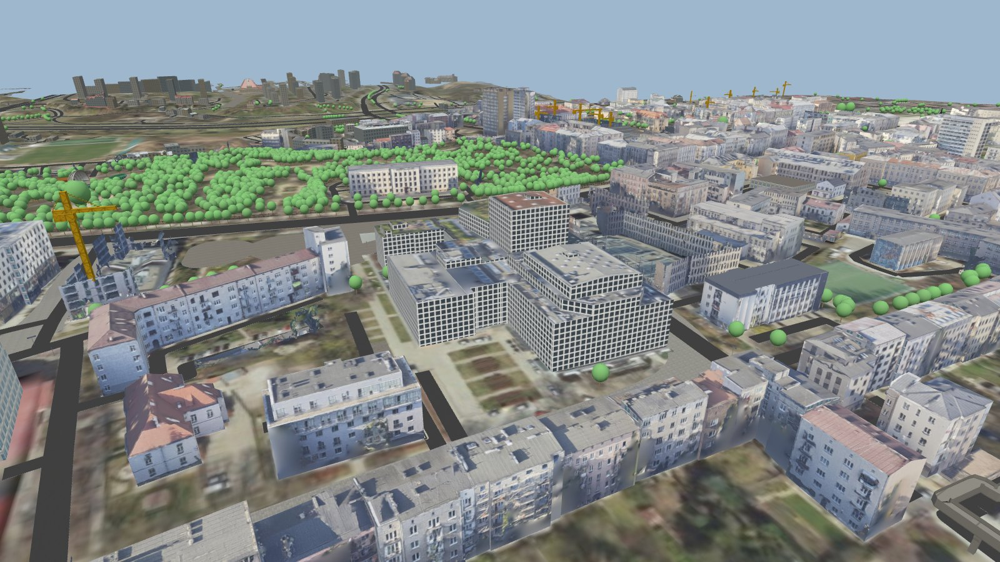 **Centre for the Meeting of Cultures** |
| 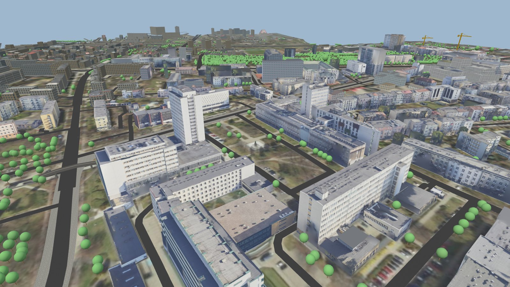 **Maria Curie-Skłodowska Square, UMCS** | 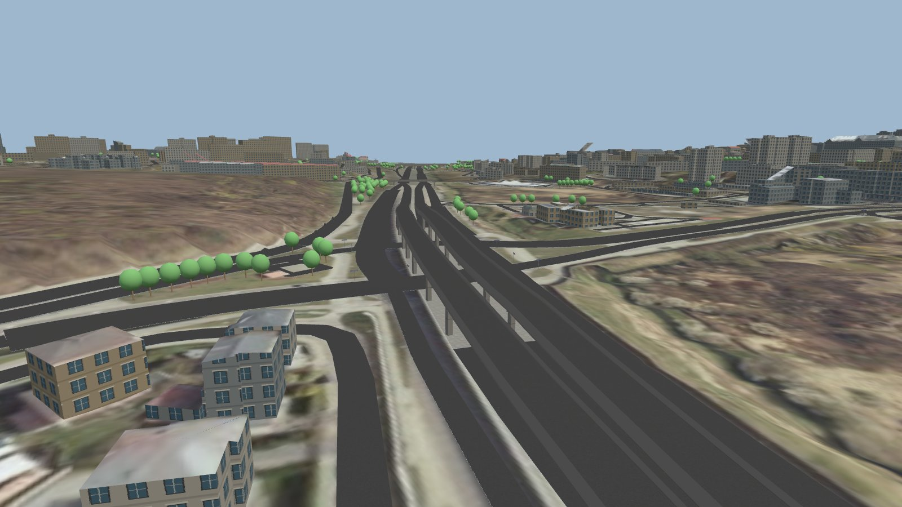 **Viaduct on Solidarności Avenue** |
| 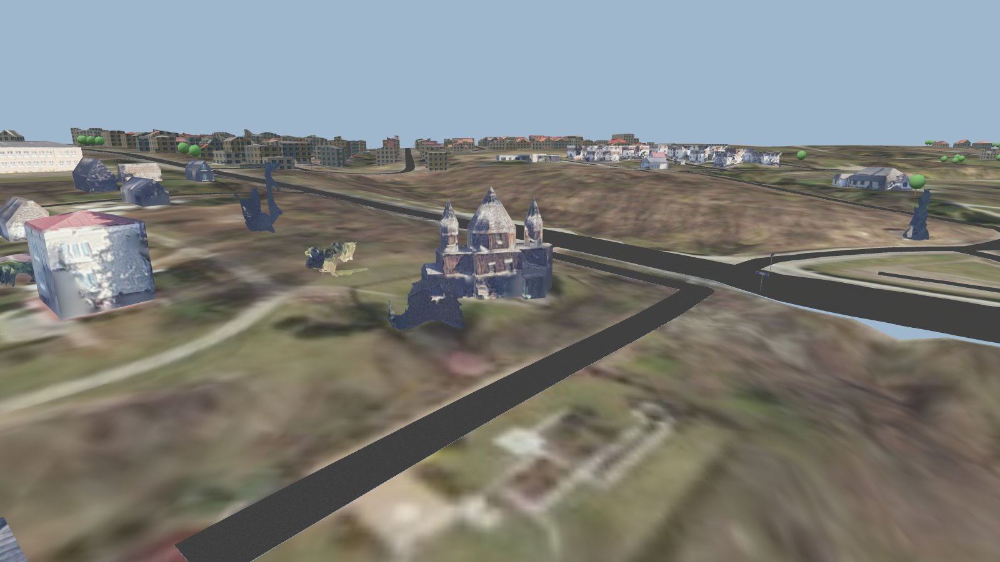 **Orthodox church by Warszawska Avenue** (Open-Air Village Museum) | 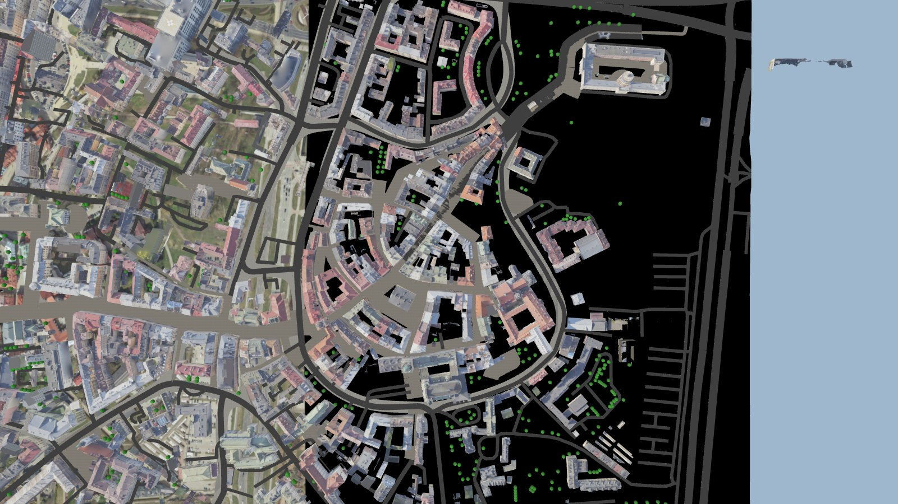 **Old Town, top view** |
| 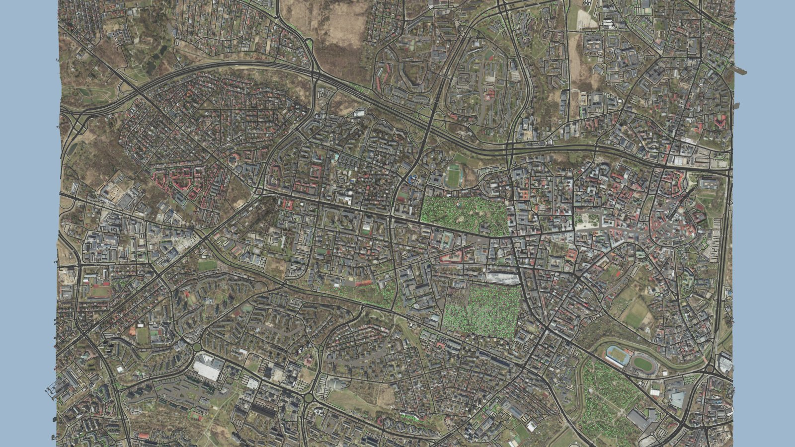 **The whole map** (≈ 4.9 × 3.5 km) | 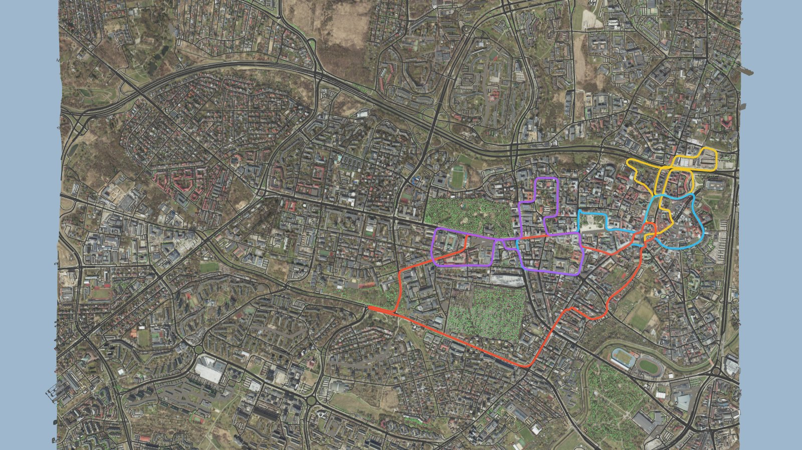 **Four race courses** (3.5–5.5 km) |

Screenshots are rendered from the release data with the repository's three.js viewer (`viewer/`)
by `tools/screenshots.cjs`.

## What's in a release

| Part | Content |
|---|---|
| `city/` | 88 cells of 512 m: terrain with orthophoto, streets (asphalt, setts on pedestrian streets, paving slabs), LoD2 buildings, viaducts and footbridges, city gates with arches, Concert Shell, CSK, Portal, monuments, cranes, street-name plates, **13,606 trees and signs** as separate breakable objects |
| `photo/` | 122 photogrammetry tiles (2022) of the centre, with buildings rebuilt from LoD2 and textured from the photos |
| `collision/` | collision meshes: drivable surfaces and walls (buildings, viaduct parapets, landmark outlines) |
| `races/` | barriers and markers for the four race courses |
| `layers/` | GeoJSON: 428 named streets, 3,568 traffic lanes, 4 race courses, trees and signs, 50 landmarks, 7,937 building footprints with heights |
| `terrain/` | 16-bit heightmap, 5 m per pixel |

Size: ≈ 640 MB without photogrammetry, 2.9 GB with it. Format: [docs/format.md](docs/format.md).

## Quick start

1. Download from **Releases**: `lublin-open-map-core.zip` and optionally
   `lublin-open-map-photo-*.zip`. Unzip them all into `dist/` in the repository.
2. View the map in the browser:
   ```sh
   python3 -m http.server 8765
   # open http://127.0.0.1:8765/viewer/?data=../dist#stare-miasto
   ```
3. Cut an area for your game, e.g. 400 m around the Market Square:
   ```sh
   python3 tools/subset.py --data dist --center 2300,-20 --size 400 --out rynek --local
   ```
4. Import it following a guide in [docs/integration/](docs/integration/README.md).

## Integrations

| Engines and open-source projects | Simulators | Classic games |
|---|---|---|
| [Godot 4](docs/integration/godot.md) | [BeamNG.drive](docs/integration/beamng.md) | [Need for Speed III / High Stakes](docs/integration/classic-games.md#need-for-speed-iii-hot-pursuit--need-for-speed-high-stakes), [Underground 2 (OpenUG2)](docs/integration/classic-games.md#need-for-speed-underground-2) |
| [Unity](docs/integration/unity.md), [Unreal Engine 5](docs/integration/unreal.md) | [Assetto Corsa](docs/integration/assetto-corsa.md) | [Trackmania](docs/integration/classic-games.md#trackmania-2020), [Euro Truck Simulator 2](docs/integration/classic-games.md#euro-truck-simulator-2) |
| [Blender](docs/integration/blender.md), [three.js, Babylon, Cesium](docs/integration/web.md) | [X-Plane](docs/integration/classic-games.md#x-plane), [FlightGear](docs/integration/open-source-games.md#flightgear) | [Cities: Skylines](docs/integration/classic-games.md#cities-skylines), [Minecraft](docs/integration/classic-games.md#minecraft-and-luanti) |
| [SuperTuxKart, Rigs of Rods, Luanti](docs/integration/open-source-games.md) | | |


### With AI

[AGENTS.md](AGENTS.md) holds the data contract and the rules. Open the repository in Claude Code
(or another agent) and ask, for example: *"Turn the Old Town race course into a SuperTuxKart track."*

## Coordinates

Geometry is in local metres: X east, Y north, Z up, `local = EPSG:2180 − (746600, 381750, 180)`.
glTF files are Y up: `gltf = (x, z, −y)`. Details and conversions for Unity, Unreal and Valve
engines: [docs/format.md](docs/format.md#coordinates).

## Building from source

The whole pipeline (downloading GUGiK, OSM and city mesh data, building the city, export) is in
`pipeline/`. Steps: [docs/pipeline.md](docs/pipeline.md).

## Known limitations

- Photogrammetry is from 2022, LoD2 buildings from 2017; orthophoto acquisition dates were not
  determined.
- A few photogrammetry fragments float in the air in the Old Town (near the Trinitarian Tower and
  Jezuicka street).
- Cranes were placed where the 2022 mesh showed crane jibs; they may be gone today.
- Outside the photogrammetry zone, buildings are LoD2 blocks with procedural facades.
- Viaduct heights come from the surface model and may be off by a few tens of centimetres.

## Licences

Code, documentation and own models: **MIT**. Data: GUGiK (orthophoto, terrain; LoD2 buildings under
CC BY 4.0), OpenStreetMap (ODbL 1.0), City of Lublin 3D mesh. Details, the attribution block and
the terms for the city mesh: [LICENSES.en.md](LICENSES.en.md).

## Contributing

Ports to more games, fixes to landmarks and new districts are welcome. Open an issue or a pull
request; for ports, include a screenshot and what you verified in the game.

Built with the help of [Claude Code](https://claude.com/claude-code).
