# Lublin Open Map

**Otwarta mapa 3D centrum Lublina do gier i silników.** Około 5 × 3,5 km miasta:
fotogrametria Starego Miasta i Śródmieścia, budynki 3D, ulice z prawdziwymi nawierzchniami,
wiadukty z filarami, charakterystyczne obiekty, drzewa i znaki do przewracania, kolizje,
cztery trasy wyścigów i sieć pasów ruchu. Wszystko w otwartych formatach (glTF 2.0, GeoJSON,
PNG), z opisem integracji z silnikami open source, symulatorami i klasycznymi grami.

[English](README.en.md) · [Format danych](docs/format.md) · [Integracje](docs/integration/README.md) ·
[Licencje](LICENSES.md) · [Dla agentów AI](AGENTS.md)

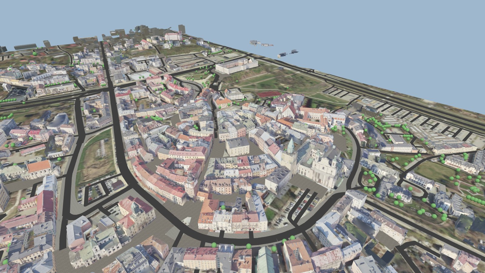

## Galeria

| | |
|---|---|
| 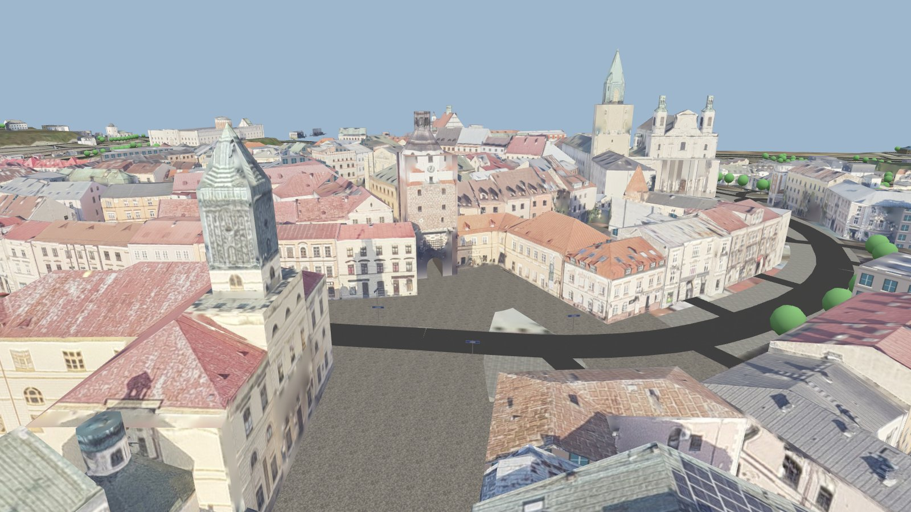 **Brama Krakowska** od strony placu Łokietka | 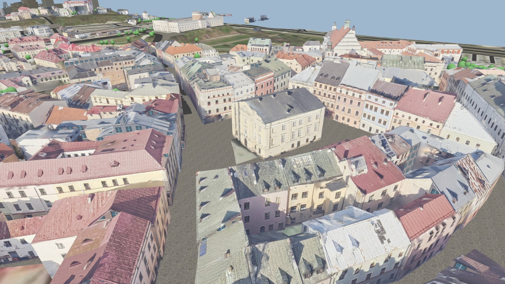 **Rynek i Trybunał Koronny** |
| 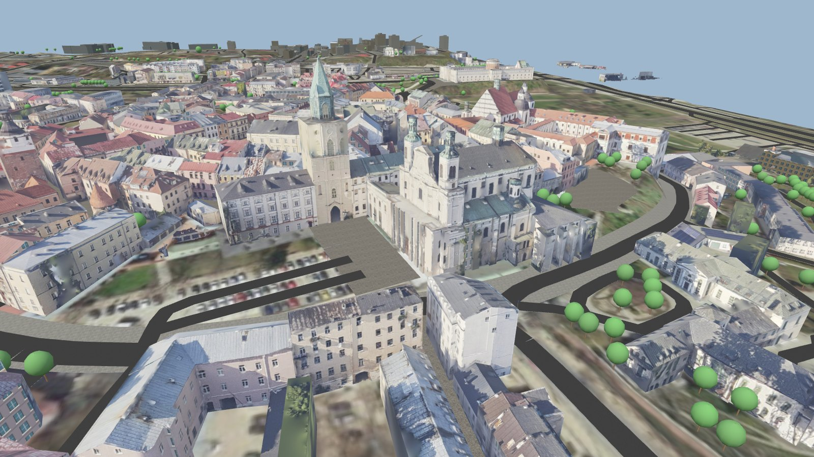 **Archikatedra i Wieża Trynitarska** | 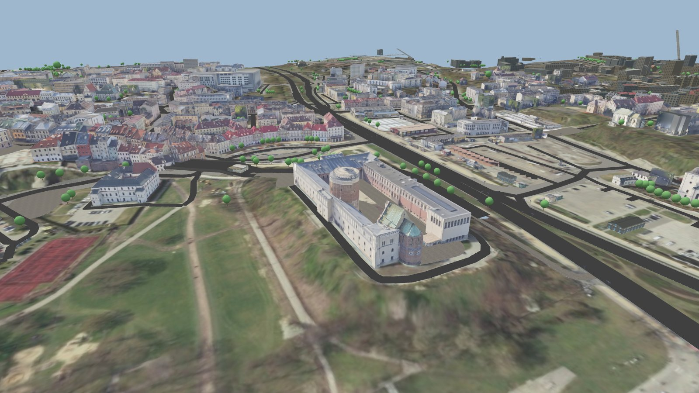 **Zamek Lubelski** |
| 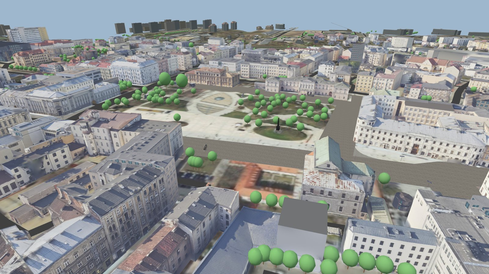 **Plac Litewski** z Pomnikiem Unii Lubelskiej i Portalem Wilno-Lublin | 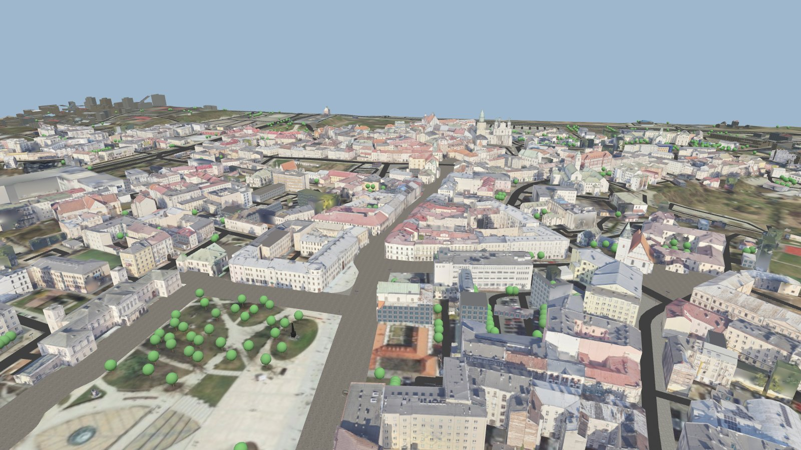 **Krakowskie Przedmieście** |
| 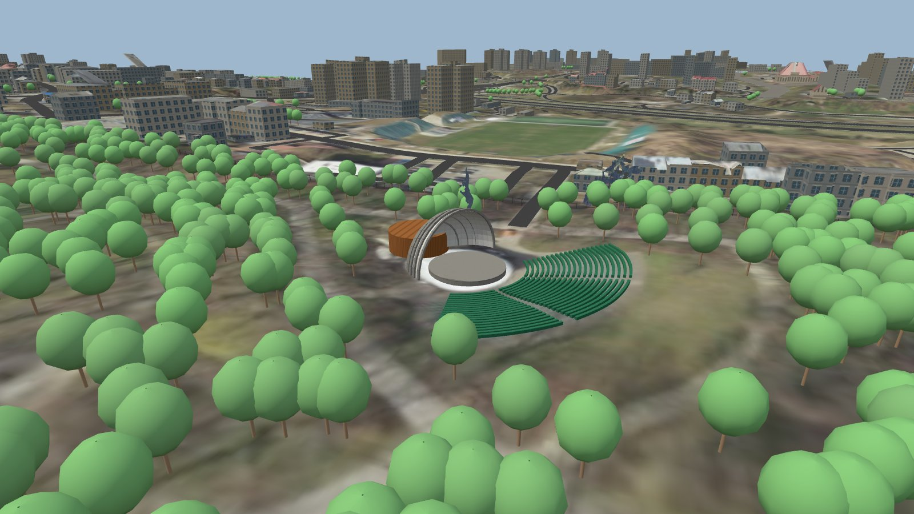 **Muszla Koncertowa w Ogrodzie Saskim** | 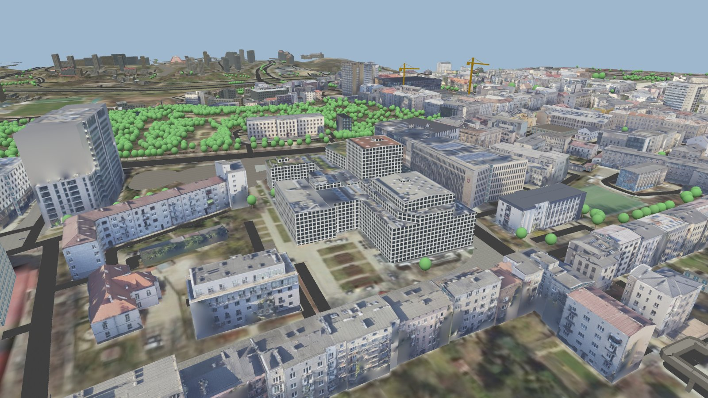 **Centrum Spotkania Kultur** |
| 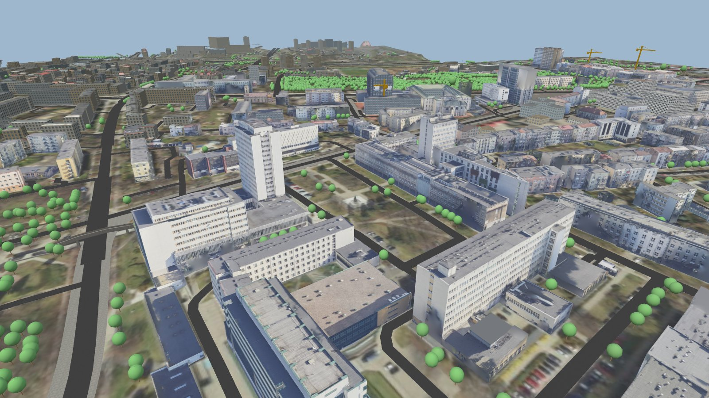 **Plac Marii Curie-Skłodowskiej, UMCS** | 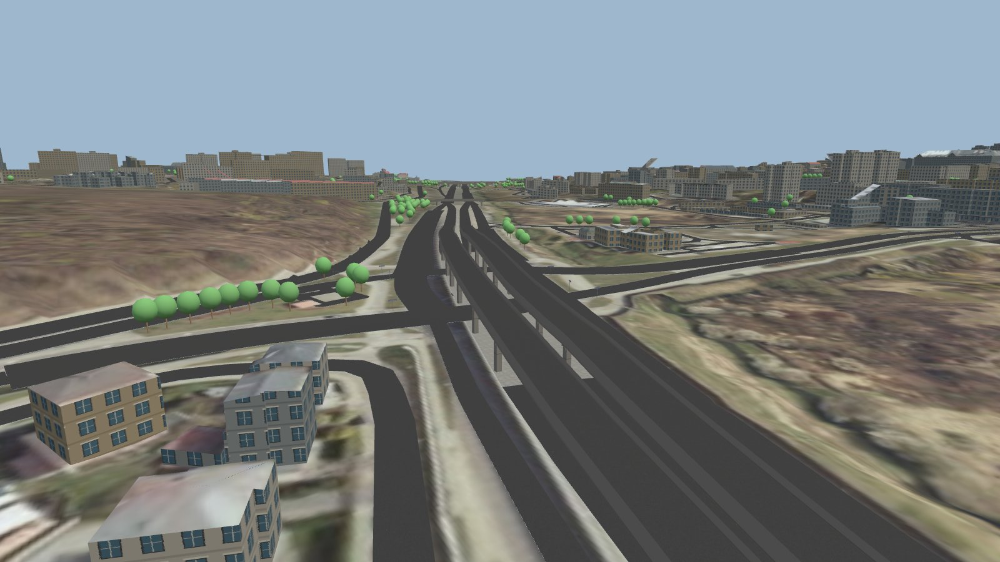 **Wiadukt w Alei Solidarności** |
| 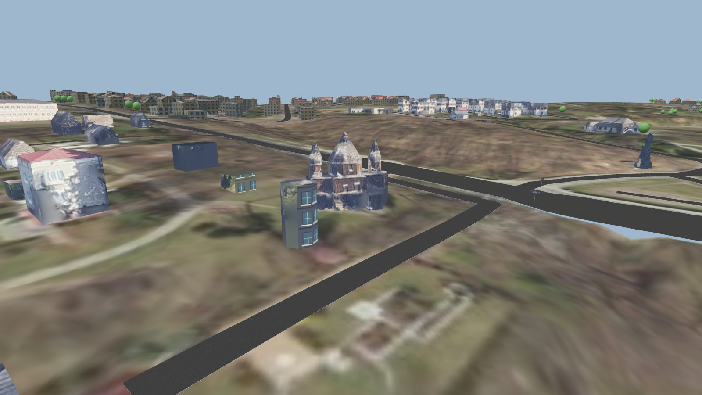 **Cerkiew przy Alei Warszawskiej** (Muzeum Wsi Lubelskiej) | 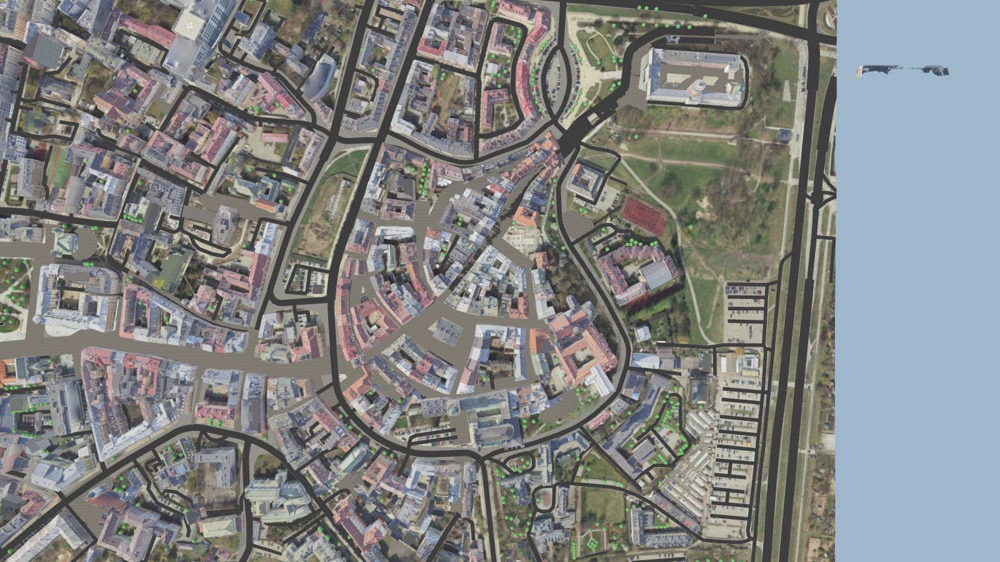 **Stare Miasto z góry** |
| 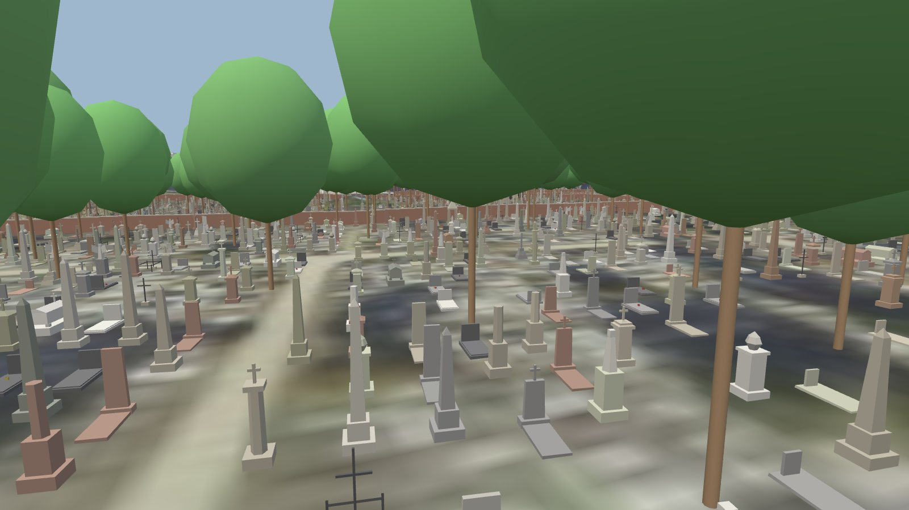 **Cmentarz przy ul. Lipowej** (nagrobki proceduralne) | |
| 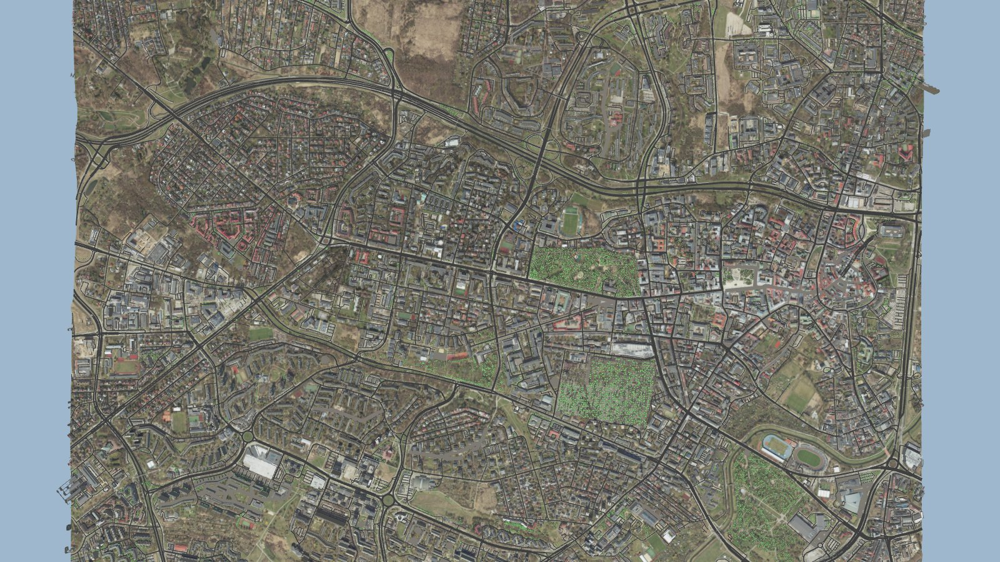 **Cały obszar mapy** (ok. 4,9 × 3,5 km) | 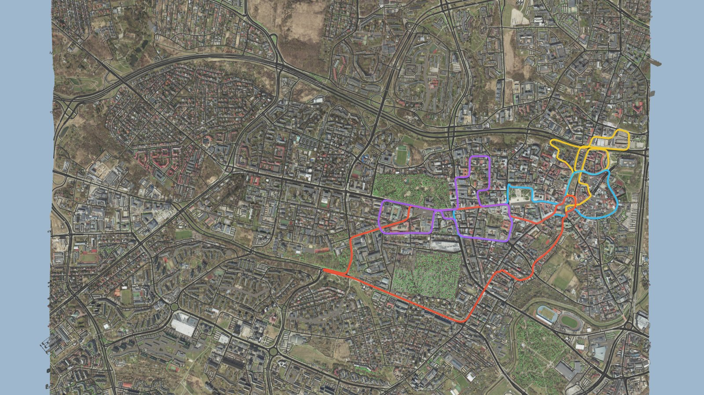 **Cztery trasy wyścigów** (3,5–5,5 km) |

Zrzuty pochodzą z przeglądarki z tego repozytorium (`viewer/`, three.js), wyrenderowanej
z danych wydania skryptem `tools/screenshots.cjs`.

## Co jest w paczce

| Część | Zawartość |
|---|---|
| `city/` | 88 komórek po 512 m: teren z ortofotomapą, ulice (asfalt, kostka na deptakach, płyty chodnikowe), budynki LoD2, wiadukty i kładki, bramy z przejazdami, Muszla Koncertowa, CSK, Portal Wilno-Lublin, pomniki, cmentarz przy ul. Lipowej i pozostałe cmentarze chrześcijańskie (aleje, nagrobki, mury), żurawie, tablice z nazwami ulic, **14 388 drzew i znaków** jako osobne obiekty do przewracania |
| `photo/` | 122 kafle fotogrametrii (2022) centrum miasta, z budynkami odbudowanymi z LoD2 i oteksturowanymi zdjęciami; budynki nowsze niż LoD2 (z OpenStreetMap) jako bryły LoD1 |
| `collision/` | siatki kolizji: nawierzchnie i ściany (budynki, bariery wiaduktów, obrysy obiektów) |
| `races/` | bariery i oznaczenia czterech tras wyścigów |
| `layers/` | GeoJSON: 428 ulic z nazwami, 3568 pasów ruchu, 4 trasy, drzewa i znaki, 50 punktów charakterystycznych, 7937 obrysów budynków z wysokościami |
| `terrain/` | mapa wysokości 16-bit, 5 m na piksel |

Rozmiar: około 690 MB bez fotogrametrii, 2,1 GB z nią. Opis formatu: [docs/format.md](docs/format.md).

## Szybki start

1. Pobierz paczki z zakładki **Releases**: `lublin-open-map-core.zip` oraz (opcjonalnie)
   `lublin-open-map-photo-*.zip`. Rozpakuj wszystkie do katalogu `dist/` w repozytorium.
2. Obejrzyj mapę w przeglądarce:
   ```sh
   python3 -m http.server 8765
   # otwórz http://127.0.0.1:8765/viewer/?data=../dist#stare-miasto
   ```
3. Wytnij fragment dla swojej gry, np. 400 m wokół Rynku:
   ```sh
   python3 tools/subset.py --data dist --center 2300,-20 --size 400 --out rynek --local
   ```
4. Zaimportuj do silnika według przewodnika z [docs/integration/](docs/integration/README.md).

## Integracje

| Silniki i projekty open source | Symulatory | Klasyki |
|---|---|---|
| [Godot 4](docs/integration/godot.md) | [BeamNG.drive](docs/integration/beamng.md) | [Need for Speed III / High Stakes](docs/integration/classic-games.md#need-for-speed-iii-hot-pursuit--need-for-speed-high-stakes), [Underground 2 (OpenUG2)](docs/integration/classic-games.md#need-for-speed-underground-2) |
| [Unity](docs/integration/unity.md), [Unreal Engine 5](docs/integration/unreal.md) | [Assetto Corsa](docs/integration/assetto-corsa.md) | [Trackmania](docs/integration/classic-games.md#trackmania-2020), [Euro Truck Simulator 2](docs/integration/classic-games.md#euro-truck-simulator-2) |
| [Blender](docs/integration/blender.md), [three.js, Babylon, Cesium](docs/integration/web.md) | [X-Plane](docs/integration/classic-games.md#x-plane), [FlightGear](docs/integration/open-source-games.md#flightgear) | [Cities: Skylines](docs/integration/classic-games.md#cities-skylines), [Minecraft](docs/integration/classic-games.md#minecraft-and-luanti) |
| [SuperTuxKart, Rigs of Rods, Luanti](docs/integration/open-source-games.md) | | |

Przewodniki są po angielsku, żeby mogła z nich korzystać społeczność modderów z całego świata.

### Z pomocą AI

Repozytorium ma [AGENTS.md](AGENTS.md) z kontraktem danych i zasadami. Wystarczy otworzyć je
w Claude Code (lub innym agencie) i poprosić np.: *„Zrób z trasy przez Stare Miasto tor do SuperTuxKart”*.

## Układ współrzędnych

Geometria jest w lokalnych metrach: X na wschód, Y na północ, Z w górę,
`lokalne = EPSG:2180 − (746600, 381750, 180)`. Pliki glTF mają oś Y w górę: `gltf = (x, z, −y)`.
Szczegóły i przeliczenia dla Unity, Unreala i silników Valve: [docs/format.md](docs/format.md#coordinates).

## Budowanie od zera

Cały pipeline (pobieranie danych GUGiK, OSM i siatki miasta, budowa miasta, eksport) jest
w `pipeline/`. Opis kroków: [docs/pipeline.md](docs/pipeline.md).

## Znane ograniczenia

- Fotogrametria pochodzi z 2022 r., budynki LoD2 ze stanu na 2017 r.; daty zdjęć ortofotomapy
  nie zostały ustalone.
- W kilku miejscach Starego Miasta (m.in. przy Wieży Trynitarskiej i ul. Jezuickiej) wiszą
  pojedyncze fragmenty fotogrametrii.
- Żurawie: dwa przy budowie Rezydencji Ogród Saski (rozpoczętej w marcu 2022 r.), potwierdzone
  w źródłach i zmierzone w siatce z 2022 r.; budowę oddano w 2024 r.
- Budynki nowsze niż LoD2 (obrysy z OpenStreetMap) są prostymi bryłami LoD1 z wysokością dachu
  zmierzoną w siatce z 2022 r. i kolorem ze zdjęć; wiaty (`building=roof`) to dach na słupach.
  Pomiar łapie też korony drzew i dźwigi, więc wysokość ogranicza tag OSM `height` lub
  `building:levels` (3,3 m na kondygnację), a dla garaży, szop i wiat typ budynku; obrysy bez tagów
  z nieprawdopodobnie smukłą bryłą zostają w fotogrametrii.
- Nagrobki na cmentarzach są rozmieszczone proceduralnie: obrysy, aleje i mury pochodzą z OSM,
  a położenie i forma grobów nie odpowiadają rzeczywistym kwaterom. Formy (krzyże żeliwne
  i kamienne, obeliski, stele, złamane kolumny, sarkofagi, figury) wzorowano na opisach plastyki
  nagrobnej cmentarza przy ul. Lipowej. Cmentarzy żydowskich nie modelowano.
- Poza strefą fotogrametrii budynki to bryły LoD2 z fasadami proceduralnymi.
- Wysokości wiaduktów są wyznaczone z modelu pokrycia terenu i mogą odbiegać od rzeczywistych
  o kilkadziesiąt centymetrów.

## Licencje

Kod, dokumentacja i modele własne: **MIT**. Dane: GUGiK (ortofotomapa, teren; budynki LoD2 na
CC BY 4.0), OpenStreetMap (ODbL 1.0), siatka 3D Urzędu Miasta Lublin. Szczegóły, podpis do
skopiowania i zasady dla siatki miasta: [LICENSES.md](LICENSES.md).

## Współtworzenie

Mile widziane: porty do kolejnych gier, poprawki obiektów, nowe dzielnice. Zgłoś issue albo
pull request; przy portach dołącz zrzut ekranu i opis, co sprawdzono w grze.

Mapa powstała z pomocą [Claude Code](https://claude.com/claude-code).
